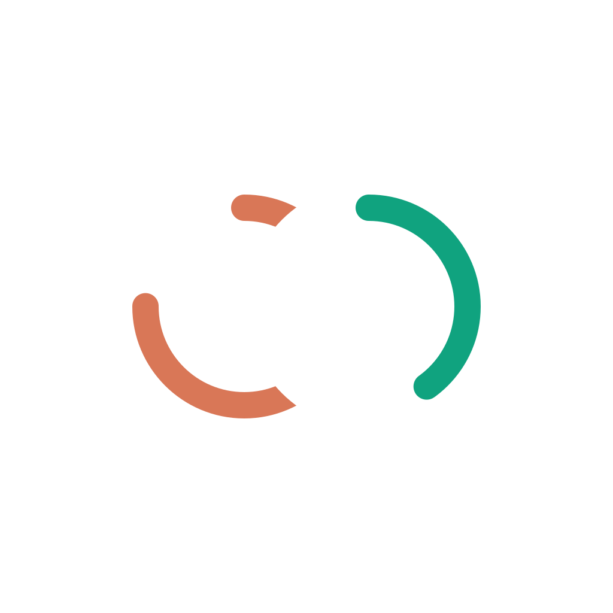

# Usage Rings

Two glass rings on the desktop: how much of your Claude and ChatGPT allowance
is gone, and when it comes back.



## Where the numbers come from

Both services expose the readings their own CLIs draw, from endpoints that cost
nothing to call — no model tokens, no session in progress:

| | endpoint | credential |
|---|---|---|
| Claude | `api.anthropic.com/api/oauth/usage` | login keychain, `Claude Code-credentials` |
| ChatGPT | `chatgpt.com/backend-api/wham/usage` | `~/.codex/auth.json` |

The Claude figure covers everything on the subscription, claude.ai chat
included — not just Claude Code. Tokens are read at request time, passed
straight to the request, and never written anywhere by this app.

Three other routes were tried first and rejected: caching what Claude Code
feeds its status line (only populated by a live session), launching Claude Code
headlessly (no `rate_limits` until an API call happens), and `claude -p` (no
limits in the output, and 2.8¢ per probe).

## Widget

Usage Rings is also a real macOS widget (small and medium): right-click the
desktop › Edit Widgets › Usage Rings. The app does the fetching (the widget is
sandboxed and can't read the credentials) and hands each reading to the widget
through `~/Library/Application Support/UsageRings/usage.json` (the widget has a
read-only sandbox exception for that folder; an app-group container needs a
provisioning profile on macOS 15+), reloading it only when a number changes. The old floating desktop rings are off by default;
the menu's *Show Desktop Rings* brings them back.

Build with `./build.sh --install` (XcodeGen + xcodebuild, then signed with the
Apple Development identity).

## Reading a ring

The thick outer arc, and the number in the middle, are the **short window** —
the one you bump into mid-session. The thin inner arc is the **weekly** window.
A plan that only reports one window gets it drawn as the bold outer arc rather
than a stray hairline, so ChatGPT on a `prolite` plan shows a single ring.

Arcs run brand-coloured, amber past 50%, red past 80% — the same thresholds a
Claude Code status line uses, so the two never disagree about what is worrying.

- **Click** a ring to refresh now.
- **Double-click** a ring to raise the detail card: both windows, with absolute
  reset times.
- **Drag** the glass to move the pair; the position persists.
- **Hover** for the same detail as a tooltip.
- The menu bar item has Refresh Now, Keep in Front, and Open at Login.

By default the rings sit at desktop level — visible when you look at the
desktop, out of the way while you work. *Keep in Front* lifts them above
ordinary windows.

## Battery

A refresh is two small GETs, so the cost is a radio wake rather than money. It
polls every 5 minutes, stretches to 30 in Low Power Mode, and **tears the timer
down entirely** while the display sleeps, refreshing the moment it wakes.

## Build

```sh
./build.sh              # build/UsageRings.app
./build.sh --install    # into /Applications, and launch
./scripts/makeicon.sh   # re-render Resources/UsageRings.icns: Kit's family plate + Glyph.svg
```

`UsageRings --dump` prints what the rings would draw, through the same fetch
path, so a suspicious number can be checked without squinting at a circle:

```
Claude  · session 3%  week 10%  resets in 2h
ChatGPT · week 0%  resets in Sat
```

Requires macOS 26 — the rings use the system's Liquid Glass material.
