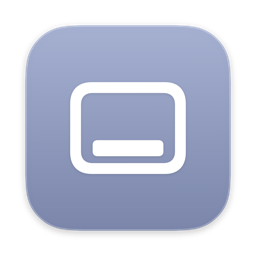
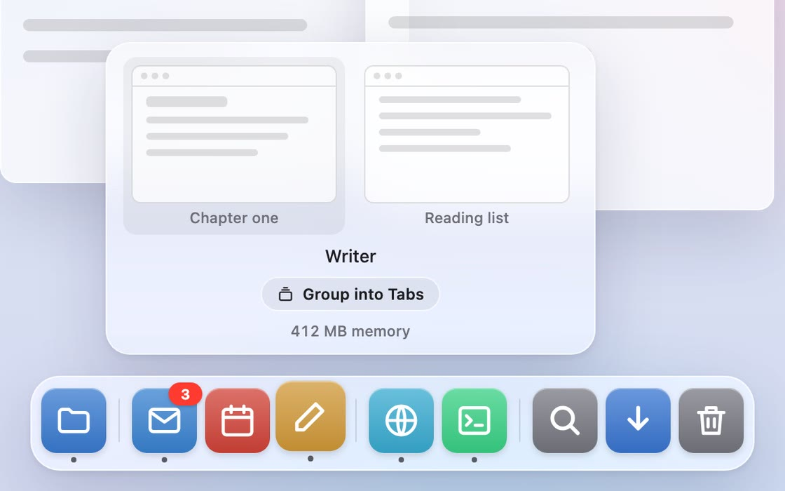
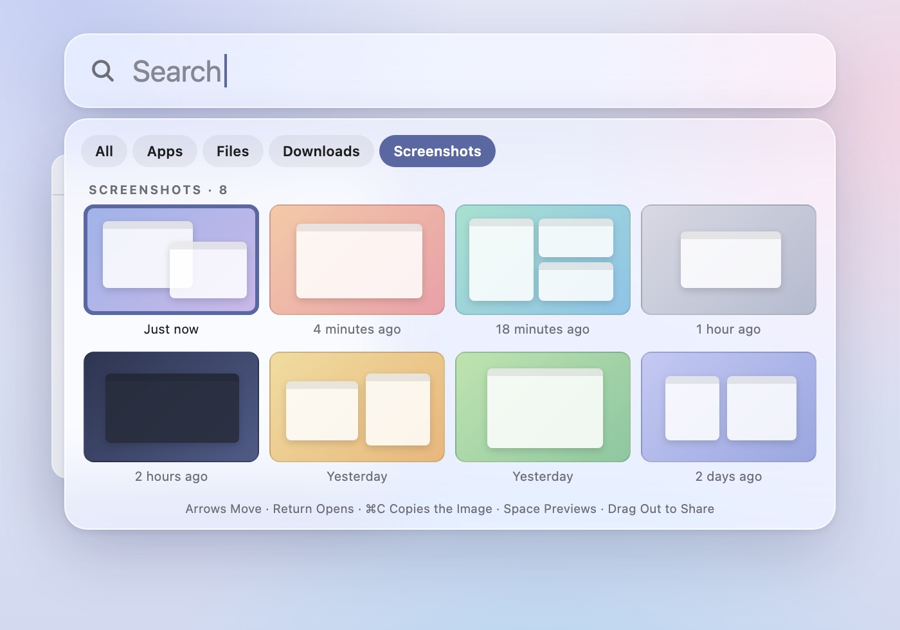
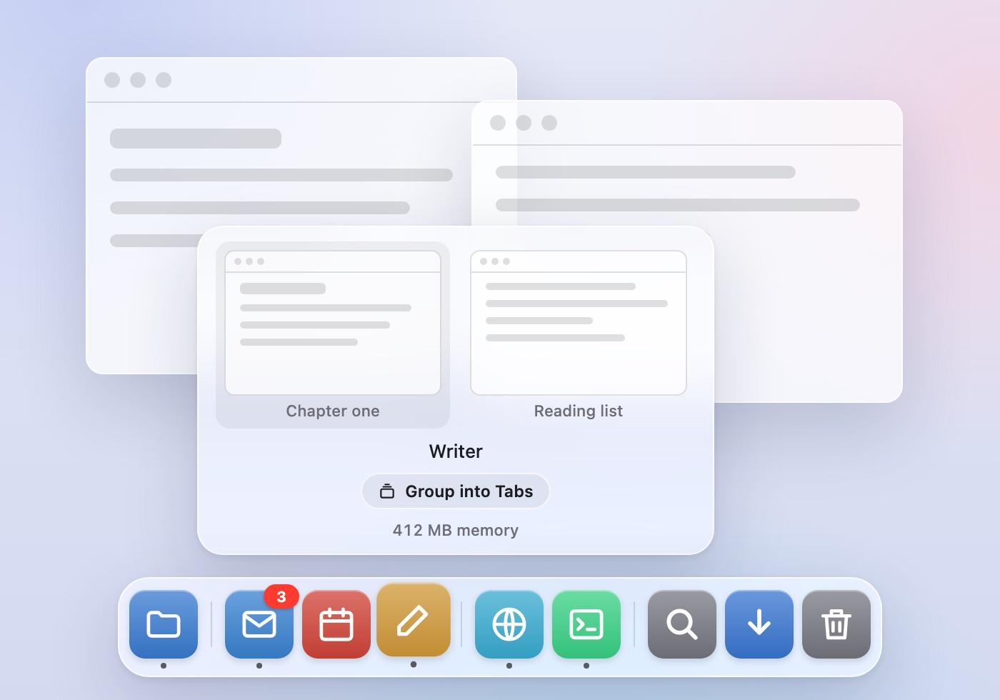
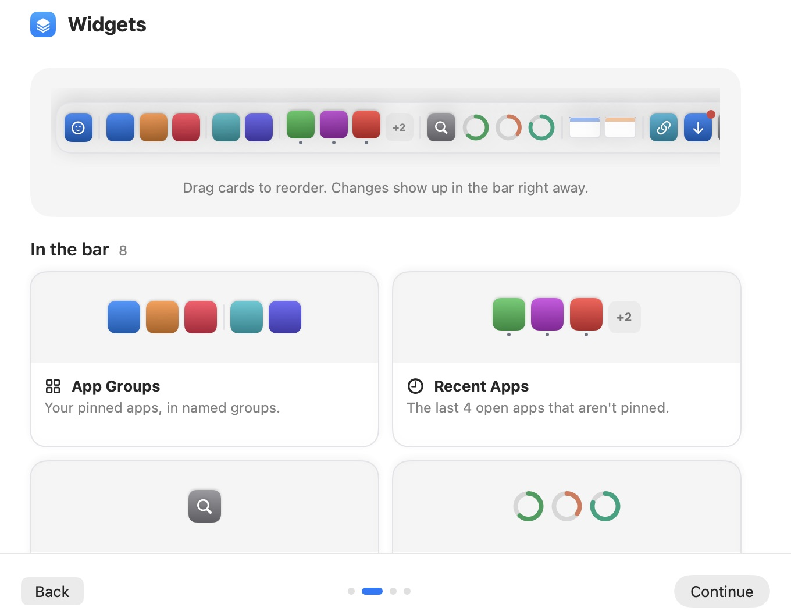
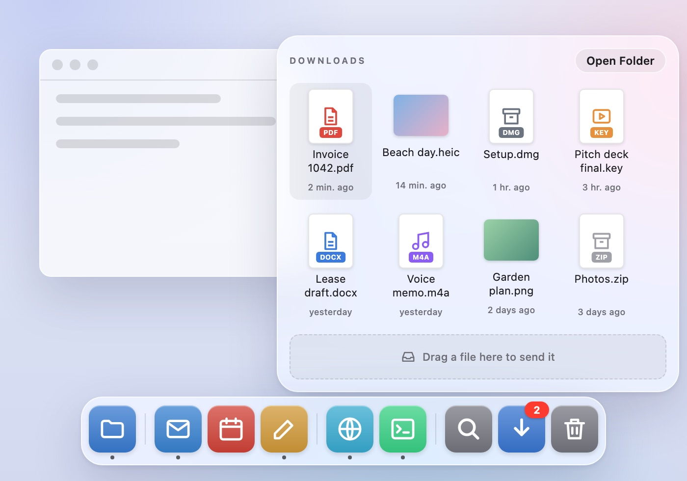
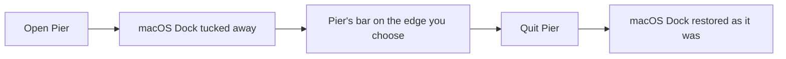

<div align="center">



# Pier

A replacement for the macOS Dock: your apps in named groups, a search panel, your downloads,<br>
and live memory and AI-usage readings, in one bar you can rearrange.

[](https://newitools.app/pier/)
[](https://github.com/andrewneuwirth/pier/releases/latest)
[](https://github.com/andrewneuwirth/pier/actions/workflows/ci.yml)
[](Package.swift)
[](LICENSE)

[**Download**](https://github.com/andrewneuwirth/pier/releases/latest) · [Website](https://newitools.app/pier/) · [Privacy](PRIVACY.md)

<br>

<picture>
  <source media="(prefers-color-scheme: dark)" srcset="docs/hero-dark.jpg">
  
</picture>

</div>

## Features

| App groups | Widgets you choose | Search |
| --- | --- | --- |
| Pinned apps in named groups. Drag apps on to pin, off to unpin, along the bar to reorder. | Recent Apps, Search, Memory & AI Usage, Minimized Windows, Quick Links, Projects, Downloads, Trash and more. Show, hide and reorder them in **Customize Pier…** (right-click the bar). | ⌥Space, or ⌘Space once Spotlight's shortcut is off: apps, System Settings panes, files from Spotlight, links, and your newest screenshots with ⌘C to copy. |
| **Windows** | **Downloads** | **Memory and AI limits** |
| Hover previews of an app's windows, a window list and tab groups on right-click, unread badges. | Newest first, with a drop zone for sending files. | Memory, heat and AI limits (Claude, ChatGPT) at a glance. |
| **Placement** | **Walkthrough** | **No server** |
| Bottom or right edge, on the display you pick. | Import your Dock's apps, pick widgets, grant permissions, set up search. | SwiftUI and AppKit, running entirely on your Mac. |

## Screenshots

<table>
<tr>
<td width="50%"><picture><source media="(prefers-color-scheme: dark)" srcset="docs/search-dark.jpg"></picture><br><sub>Search, on the Screenshots tab</sub></td>
<td width="50%"><picture><source media="(prefers-color-scheme: dark)" srcset="docs/windows-dark.jpg"></picture><br><sub>Window previews and tab groups</sub></td>
</tr>
<tr>
<td width="50%"><picture><source media="(prefers-color-scheme: dark)" srcset="docs/widgets-dark.jpg"></picture><br><sub>Picking widgets</sub></td>
<td width="50%"><picture><source media="(prefers-color-scheme: dark)" srcset="docs/downloads-dark.jpg"></picture><br><sub>Downloads, with the send zone</sub></td>
</tr>
</table>

## How it swaps in

Quitting Pier puts your macOS Dock back exactly as it was.



## Install

Download `Pier-0.1.0.dmg` from [Releases](https://github.com/andrewneuwirth/pier/releases/latest), open it and drag Pier to Applications. It's signed with Developer ID and notarized by Apple, and needs macOS 26.

### Build from source

Needs Xcode 26 or later (Swift 6.2 tools) on macOS 26.

```sh
git clone https://github.com/andrewneuwirth/pier.git Pier && cd Pier
swift build && .build/debug/Pier --self-check   # should print "self-check ok"
./build.sh                                      # makes build/Pier.app
open build/Pier.app
```

Pier uses MacToolsKit from [mac-tools-kit](https://github.com/andrewneuwirth/mac-tools-kit); SwiftPM fetches it, or uses a checkout at
`../Kit` if you have one. `build.sh` signs with your Apple Development identity if you have one (a stable signature keeps
the Accessibility and Screen Recording grants across rebuilds), otherwise ad hoc. To use your own bundle id or signing
identity, copy `config.example.env` to `config.local.env` and edit it.

## Permissions

Pier works without any, with fewer features. The walkthrough and Customize Pier… › Permissions show what's on.

| Permission | Adds |
| --- | --- |
| Accessibility | Window menus, tab groups, unread badges, keeping windows clear of the bar, pasting screenshots |
| Screen Recording | Window previews |

## Automation

Other tools (Hammerspoon, a mouse utility) can post these distributed notifications:

| Notification | Does |
| --- | --- |
| `app.newitools.pier.search` | Opens or closes search |
| `app.newitools.pier.pasteScreenshot` | Pastes the newest screenshot from the last 10 minutes into the front app |

## Privacy

Pier runs entirely on your Mac and collects nothing. The only requests it makes are for website icons and, if you're
signed in to Claude Code or Codex, your plan usage from those services. Full policy: [PRIVACY.md](PRIVACY.md).

## Contributing

See [CONTRIBUTING.md](CONTRIBUTING.md). Security issues: [SECURITY.md](SECURITY.md).

## License

[MIT](LICENSE). Pier is part of [newi tools](https://newitools.app/pier/).
